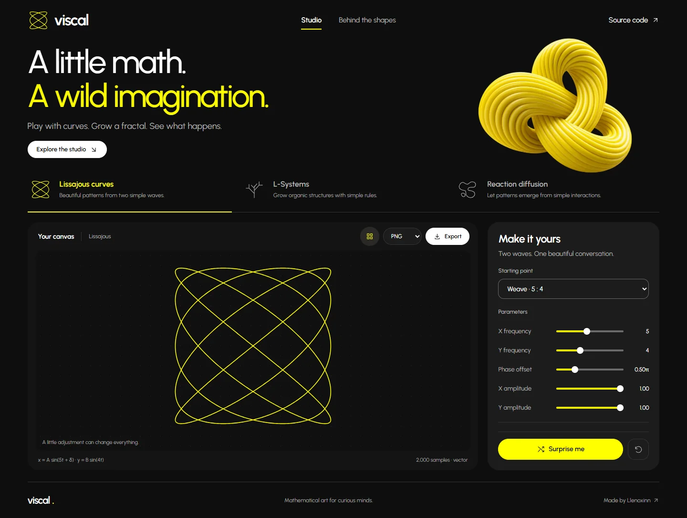

# Viscal

### A little math. A wild imagination.

A generative art playground that runs entirely in your browser. Shape a curve, grow a fractal, or paint a living chemical pattern, then export your creation.



## Start creating

Use **Node.js 24 LTS** (recommended; Node 22.12+ is supported) and npm. The `.nvmrc` file selects Node 24 for version managers.

```sh
npm ci
npm run dev
```

Open the URL printed in your terminal, usually [localhost:5173](http://localhost:5173). Changes appear immediately through Vite's React Fast Refresh.

To check the production version locally:

```sh
npm run build
npm run preview
```

Vite writes the static website to `dist/`. Deploy that directory to a static host; no server, database, credentials, or environment variables are required.

## Three ways to experiment

| Engine                 | What you can change                                                                      | Starting points                                   |
| ---------------------- | ---------------------------------------------------------------------------------------- | ------------------------------------------------- |
| **Lissajous curves**   | X/Y frequencies, phase, independent amplitudes, sample count, stroke, opacity, and color | Weave, Orbit, Bloom, Ribbon, Harmony              |
| **L-Systems**          | Iteration depth, branch angle, step length, stroke width, and color                      | Plant, Sierpinski triangle, Koch, Dragon, Hilbert |
| **Reaction diffusion** | Feed/kill rates, diffusion, simulation speed, and palette; paint to seed new patterns    | Spots, Stripes, Worms, Coral, Mitosis             |

Pick a starting point, adjust a slider, or select **Surprise me**. The reset button restores the engine's defaults. Switching engines preserves your current work. Use **Appearance & detail** for additional curve controls.

The simulation offers Electric yellow, Acid green, Thermal, and Grayscale palettes. Pause it to inspect a frame; palette changes, resets, and **Add seed** also work while paused. **Add seed** is a keyboard-accessible alternative to painting.

## Export your artwork

Choose a format beside **Export**:

| Format     | Curves and fractals                                      | Reaction diffusion                     |
| ---------- | -------------------------------------------------------- | -------------------------------------- |
| **PNG**    | Rendered from the vector at the displayed artwork size   | Native 240 × 180 simulation grid       |
| **PNG 2×** | Rasterized from the vector at twice the width and height | 480 × 360, with sharp pixel scaling    |
| **SVG**    | Editable vector, with the artwork's background           | Not applicable to the pixel simulation |

Export includes your selected color and stroke settings. The canvas guide grid is excluded. SVG and PNG exports use a dark background. Export errors appear beside the action and successful downloads are announced to assistive technology.

## Built with

| Layer                 | Technology                             | Purpose                                                                    |
| --------------------- | -------------------------------------- | -------------------------------------------------------------------------- |
| Interface             | React 19.3                             | Component state and accessible native controls                             |
| Development and build | Vite 8.3 + React plugin 6              | Fast Refresh and production bundles                                        |
| Rendering             | Native SVG and Canvas 2D               | Crisp vectors and interactive pixel simulations                            |
| Styling               | Plain CSS and locally bundled Urbanist | Responsive layouts without a component framework or external font requests |
| Code checks           | Oxlint                                 | Native JavaScript, React hooks, and accessibility correctness checks       |
| Regression tests      | Node's built-in test runner            | Mathematical engines and repository hygiene                                |

The fractal and simulation engines load on first use. Fractals render as a single SVG path; expansion is bounded before oversized results are allocated. The simulation reuses typed-array buffers, image data, and palette lookups. Its loop is capped at 30 updates per second and stops when the engine or browser tab is hidden.

The decorative 3D knot is an optimized 640px WebP. The variable font is bundled as one Latin WOFF2 file, so the published app does not contact a font CDN.

## Development checks

```sh
npm run check
npm audit
```

| Command              | Checks                                                                                                                         |
| -------------------- | ------------------------------------------------------------------------------------------------------------------------------ |
| `npm run dev`        | Starts the development server                                                                                                  |
| `npm run lint`       | JavaScript/JSX correctness, React hooks, and accessibility rules                                                               |
| `npm test`           | Curve bounds and closure, fractal drawing and limits, solver stability, buffer reuse, color palette, and repository path rules |
| `npm run check:repo` | Rejects tracked dependencies, build output, logs, browser artifacts, and local environment files                               |
| `npm run build`      | Creates the production site                                                                                                    |
| `npm run check`      | Runs repository checks, lint, tests, and the build                                                                             |

GitHub Actions runs the checks and dependency audit on pushes and pull requests using Node 24.

## Project map

```text
src/
  components/       Studio layout, controls, engine views, exports, and icons
  engines/          DOM-independent Lissajous, L-system, and Gray–Scott math
  hooks/            Visibility-aware animation loop and image downloads
  utils/            Shared artwork colors and simulation palettes
  App.jsx           Engine selection and preserved per-engine state
  index.css         Design tokens, responsive layouts, and interaction states
public/
  artwork/          Optimized original 3D illustration
  licenses/         Urbanist font license
scripts/            Repository hygiene checks
test/               Node regression tests
docs/               Documentation preview
```

## Keyboard and motion

- **Tab** moves through controls. The skip link jumps directly to the studio.
- **Left/Right arrows** switch engine tabs; **Home/End** select the first/last engine.
- Focus a slider and use arrow keys for precise adjustments.
- **Escape** closes the math explanation.
- Reduced-motion preferences disable press movement and start the simulation paused. You can start it explicitly with **Play**.

Artwork and settings stay in the current browser session. Reloading restores defaults. Artwork is generated locally; the application does not upload it or save it to a remote account.

## Keep Git clean

Commit source, tests, configuration, documentation assets, and **`package-lock.json`**. The lockfile's `node_modules/...` entries describe dependencies; they are metadata, not installed package files.

`.gitignore` excludes installed dependencies, build output, local environment files, logs, and browser artifacts, including nested dependency folders. The repository check catches forbidden paths even if someone stages them with `git add --force`.

If a checkout already tracks dependencies or build output, untrack them without deleting local files:

```sh
git rm -r --cached --ignore-unmatch node_modules dist
```

Commit the removal and ignore rules. This cleans the next revision; it does not rewrite existing Git history.

Use branches such as `feat/kivoo-inspired-studio`, `chore/dependency-cleanup`, or `task/update-documentation`. Git forbids colons and spaces in branch names. Use **`feat: description`**, **`chore: description`**, or **`task: description`** for commits and pull request titles.

## Design and credits

Visual direction is inspired by [KIVOO — Fintech App & Web Design](https://www.behance.net/gallery/257247241/KIVOO-Fintech-App-Web-Design): electric yellow, soft black, Urbanist, rounded controls, and tactile ribbed forms. Viscal uses its own mathematical artwork, icons, copy, and generated trefoil illustration.

See [design notes](docs/design-notes.md) for the image-first process, asset briefs, and validation decisions, or the [mobile preview](docs/mobile-preview.webp) for the responsive layout.

[Urbanist](https://fontsource.org/fonts/urbanist) is distributed under the [SIL Open Font License](public/licenses/Urbanist-OFL.txt). The Viscal trefoil illustration was generated for this project and optimized for the web.

Made by [Llenoxinn](https://github.com/Llenoxinn).
